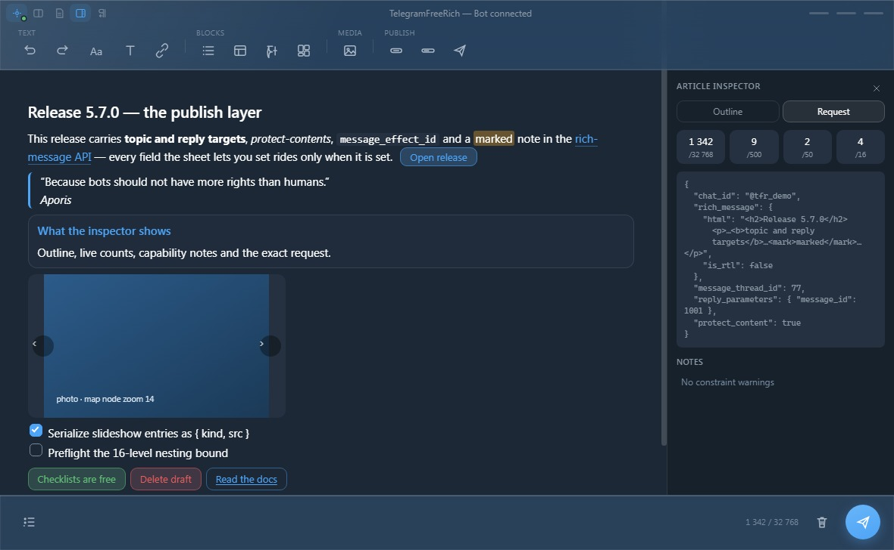
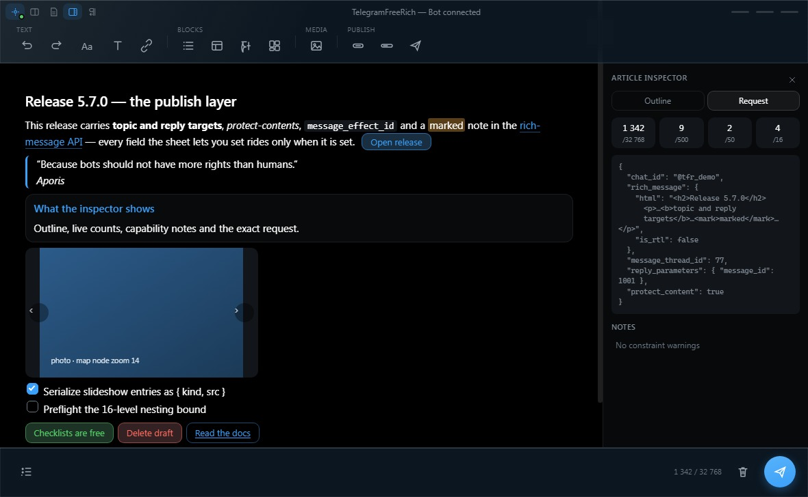
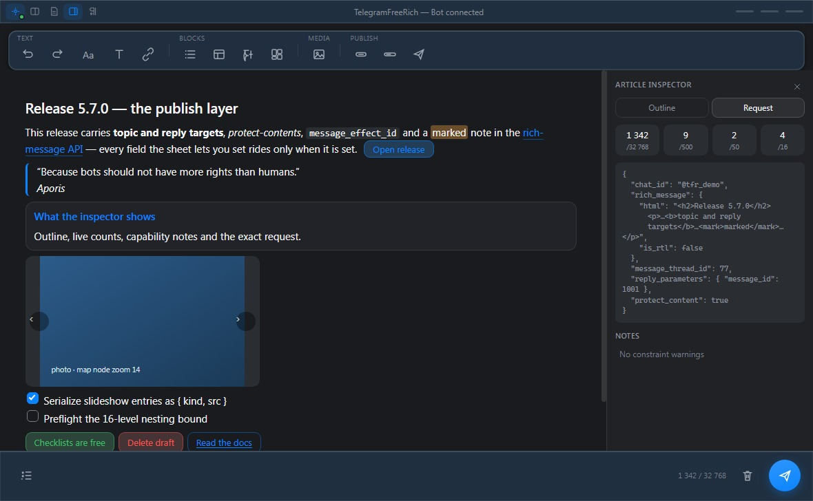
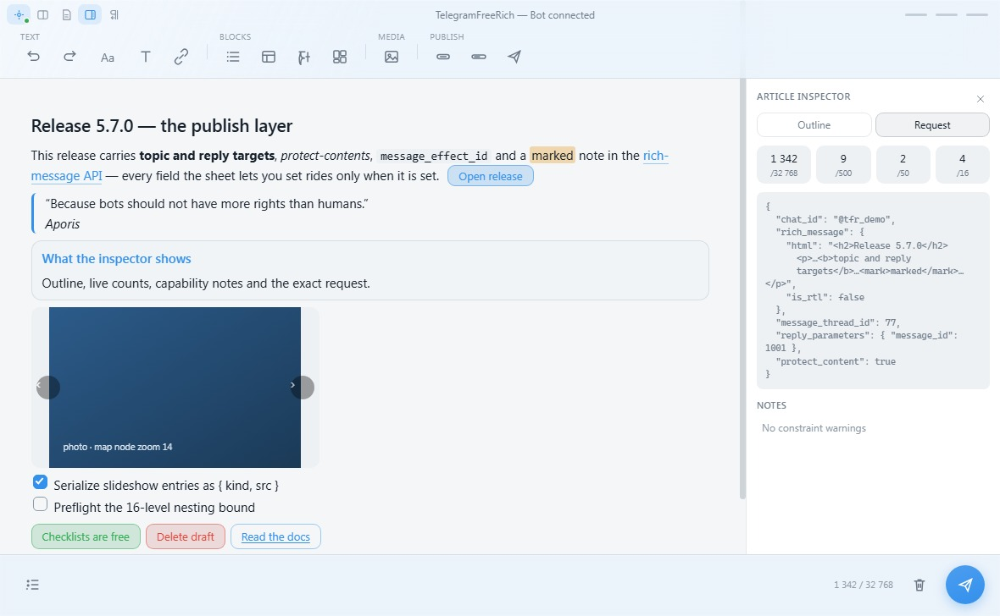

<p align="center">
  
</p>

<h1 align="center">TelegramFreeRich</h1>

<p align="center"><strong>Telegram's rich text editor — for everyone, without Premium.</strong></p>
<p align="center"><em>Because bots should not have more rights than humans.</em></p>

<p align="center">
  
  
  
  
  
  
  
  
  
</p>

<p align="center">
  <a href="README_fa.md">🇮🇷 فارسی</a> &nbsp;•&nbsp;
  <a href="#quick-start">Quick start</a> &nbsp;•&nbsp;
  <a href="#checklists">Checklists</a> &nbsp;•&nbsp;
  <a href="#window">The window</a> &nbsp;•&nbsp;
  <a href="#features">Features</a> &nbsp;•&nbsp;
  <a href="#architecture">Architecture</a> &nbsp;•&nbsp;
  <a href="#security">Security</a> &nbsp;•&nbsp;
  <a href="#troubleshooting">Troubleshooting</a> &nbsp;•&nbsp;
  <a href="#development">Development</a>
</p>

<p align="center">
  
</p>

<p align="center">
  
  
  
</p>

---

## Why this exists

In June 2026 Telegram shipped a rich text editor — and locked it behind Premium. The very same
formatting is available to **every bot, for free**, through Bot API 10.3.

|  | Telegram Premium | A bot + this app |
|---|---|---|
| Headings, quotes, tables, code blocks | 💎 Premium | ✅ Free |
| Spoilers, marked text, sub/superscript | 💎 Premium | ✅ Free |
| Checklists, collapsibles, formulas | 💎 Premium | ✅ Free |
| Monthly cost | 💸 | **0** |

No coding, no server, no subscription. Point the app at a bot token and a chat, and write.

---

<a id="quick-start"></a>

## 🚀 Quick start

**1 — Get a bot.** Message [@BotFather](https://t.me/BotFather), send `/newbot`, copy the token.
Add the bot to your channel or group as an administrator.

**2 — Install.** Grab a package from the
[latest release](https://github.com/Aporis3674/TelegramFreeRich/releases/latest):

| Platform | File | Notes |
|---|---|---|
| Windows 10/11 | `TelegramFreeRich-Setup-*.exe` | Installs for the current user — no admin rights |
| Windows 10/11 | `TelegramFreeRich-*-portable.exe` | Runs as-is, nothing to install |
| Linux | `TelegramFreeRich-*.AppImage` | `chmod +x` it and run |

Or start from source:

```bash
git clone https://github.com/Aporis3674/TelegramFreeRich.git
cd TelegramFreeRich
npm install
npm run dev
```

**3 — Configure.** Click the ⚙ gear in the title bar, paste the token and the chat ID
(`@channel` or a numeric ID), press **Test connection**, then **Save**.

Write your message and press <kbd>Ctrl</kbd>+<kbd>Enter</kbd>. That's it.

---

## 🌐 Blocked country? Use your proxy

Telegram is blocked in some countries, and people reach it through v2rayN, Nekoray or a similar
client. Those clients offer **“Set system proxy”**, which configures Windows — and therefore
Chromium — but **not Node**. Any Electron app that sends with Node's `https` module ignores it
and times out.

This app sends every Telegram request through **Chromium's network stack** (`net.request` on the
default session), so the system proxy is honoured, PAC scripts included.

Settings → **Connection**:

| Mode | When to use it |
|---|---|
| **System proxy** *(default)* | Your VPN client has “Set system proxy” enabled — nothing else to do |
| **Manual proxy** | The client only exposes a port. One click fills in v2rayN's defaults: SOCKS5 `127.0.0.1:10808` or HTTP `127.0.0.1:10809` |
| **No proxy** | Direct connection |

**Check connection to Telegram** reports which proxy Chromium resolved and whether
`api.telegram.org` answered, so a blocked network is never mistaken for a bad token. Manual
proxies may carry a username and password; the password is encrypted next to the bot token and
never reaches the window you type in.

---

<a id="checklists"></a>

## ☑ Checklists

A checklist travels **inside the message**. Rich HTML has its own task-list form —
`<ul><li><input type="checkbox" checked>done</li></ul>` — so Telegram draws real checkboxes, in a
channel, a group or a private chat alike, with the ticks you set in the editor preserved. Nothing
extra to configure; write a checklist and send it.

Telegram *also* has a second, different thing: an **interactive** checklist, sent with the
`sendChecklist` method, whose boxes readers can tick themselves. That one is restricted to a bot
acting on behalf of a connected business account, in a private chat — and it comes with its own
limits, **30 tasks** and **100 characters** each, and no way to send a task already ticked
(`markChecklistTasksAsDone` does that afterwards).

The app picks between them for you:

| Settings ▸ Business connection ID | Chat | What gets sent |
|---|---|---|
| empty *(the normal case)* | anything, channels included | checkboxes inside the message |
| set | private (numeric ID) | an interactive checklist — the app asks for its title |
| set | channel or group | checkboxes inside the message, with a note saying why |

---

<a id="window"></a>

## 🪟 The window

A faithful rebuild of Telegram Desktop's composer: frameless, dark, hairline-outlined pill
buttons and one salmon send button.

```
┌ ⚙ ◫ 🗂 ¶ ─────────────────────────────────────────  ─  □  ✕ ┐
│  Text     ( ↶ )( ↷ )( Aa )( B )( 🔗 )                         │
│  Blocks   ( ☰ )( ▦ )( Σ )( ⧉ )                                │
│  Media    ( 🖼 )                                               │
│  Publish  ( ⊞keys )( ➸inline )( ✈ options )                    │
│                                                                │
│  Message                          │  Live preview │ Article    │
│                                   │               │ inspector  │
│  ( ✦ )            342 / 32,768 ( 🗑 )        ( ➤ )             │
└────────────────────────────────────────────────────────────────┘
```

The toolbar carries four labelled groups — **Text**, **Blocks**, **Media** and
**Publish** — so the strip reads as areas instead of a wall of glyphs.

| Button | Click it and you get |
|:--:|---|
| ↶ ↷ | Undo / redo — the full ProseMirror history |
| **Aa** | **Formatting** → Heading (opens H1–H6), Text, Quote, Pull quote, **Attribution** (the `<cite>` a quote may name), Code block *(with a searchable **language** picker — empty means plain text)*, Footer, Divider |
| **B** | **Text style** → Bold, Italic, Underline, Strikethrough, Spoiler, Subscript, Superscript, Marked |
| ☰ | **Insert list** → Ordered list, Bullet list, Checklist *(see [Checklists](#checklists))*, Details *(collapsible — with its **Initially expanded** toggle)*, **Marker styles** — picked from a list (numbers, `a A i I`), **Reversed numbering**, **Explicit item number** |
| ▦ | **Insert table** → an editable 3×3 table; a minimal icon bar adds and removes rows and columns, drags column widths, and one Layout popover aligns cells horizontally and vertically, stripes or compacts rows, drops the frame (**Borderless**) and titles the table with a caption |
| 🔗 | **Insert link** → a *Create link* panel with **Text** and **URL** fields |
| Σ | **Insert formula** → typesets what you type into a **live preview** beside the LaTeX source (KaTeX, the same math Telegram draws) — inserting a new math block, or rewriting the one the caret sits in |
| ⧉ | **Collage** → a photo/video wall from URLs — two or more picked files make a **slideshow**; Telegram lets a slideshow mix photos and videos, and each entry uploads on its own channel |
| 🖼 | **Insert media** → opens the **device picker** (photos/videos from local storage, several become a slideshow; audio and documents get their own pickers) · cancel it to paste remote URLs instead · **Location** *(with zoom 0–24, optional rendered size with its documented bounds, and a caption)*, **Spoiler** (blur the media until tapped), **Caption…** (the `<figcaption>` under a media item) |
| ⊞ ➸ | **Buttons row**, the 10.3 **Inline button in text** — the interactive publish-time layer |
| ✈ | **Publish options** → the send-time sheet: forum **topic ID**, **direct-messages topic**, **reply to message**, **send silently**, **protect contents**, **message effect**, **business connection** |
| ✦ | The insert palette — search every block and format by name; also home of @mention, custom emoji, formatted time and the Thinking placeholder |
| 🗑 ➤ | Clear the message · Send it (right-click to pick rich message, draft or edit, **Schedule…**, **Scheduled queue…**, publish options and the *skip auto-detection* toggle) |

The title bar holds the settings gear with a connection dot, the **local drafts** folder, the
live-preview toggle, the **article inspector** — outline, live counts (characters, blocks, media,
nesting depth) and the exact request the app is about to send — and the right-to-left switch for
the message you are writing.

> **Premium, without Premium.** The entities bots *can* send from the rich-message API live in the
> insert palette: inline **buttons** (rows of `<tg-button-row>` or the 10.3 single chip inside a
> paragraph), **custom emoji** (`<tg-emoji>`), formatted
> **date-time** chips (`<tg-time>`), **anchors** (`<a name>`), **references** (`<tg-reference>`) and
> inline **mentions** (`tg://user?id=`). Telegram renders the artwork and live date for every
> reader.

---

<a id="features"></a>

## ✍️ What you can send

| | |
|---|---|
| **Text** | Bold · Italic · Underline · Strikethrough · Spoiler · Marked · Subscript · Superscript · Monospace · Inline formula · Links · Inline mentions · Custom (Premium) emoji · Formatted date-time |
| **Blocks** | Heading H1–H6 · Paragraph · Quote *(with attribution, **expandable to one line**)* · Pull quote *(with attribution)* · Code block — **language picked from a searchable list, empty for plain text** · Divider · Collapsible with an **Initially expanded** toggle · Footer · Formula block · Thinking placeholder *(draft mode)* |
| **Lists** | Ordered *(start, marker styles **picked from a list**, reversed, explicit item numbers)* · Bulleted · Checklist *(see [Checklists](#checklists))* |
| **Tables** | Header row, editable cells, drag-to-resize columns · Caption · Striped & compact rows · **Borderless** look · Cell `align`/`valign` · Cell `colspan`/`rowspan` |
| **Media** | Photo · Video · Audio · Document · Slideshow *(‹ › carousel — **mixes photos and videos**, each entry uploading on its own channel)* · Collage · Location — picked **from the device and uploaded with the message** or by URL — each with an optional caption and a per-figure spoiler |
| **Buttons** | Inline keyboard rows (`<tg-button-row>`) and the 10.3 in-text chip (`<tg-button>` inside a paragraph) — URL, callback data, Mini App, login, switch-inline (incl. chosen-chat filters), copy-text, disabled — with Telegram's four color themes (`primary` blue, `success` green, `danger` red, `link`), picked as swatches and tinted all the way from dialog to preview; in-text chips flow right with the paragraph and `url` buttons open their link |
| **Structure** | Anchors (`<a name>`) and references (`<tg-reference>`) through the footnote `#name` links |

And while you write:

- **Local drafts** — save the message to disk with its exact Rich HTML and RTL flag, load it again
  with one click; the current message is also mirrored to storage and offered back after a restart
- **Live preview** — a real Telegram bubble, rendered from the same document you are editing
- **Article inspector** — outline, live counts (characters, blocks, media, nesting depth) and the
  exact send steps the app is about to run — a possible `sendChecklist` first, then the rich
  request — through one shared prepare, token-free
- **Publish options** — topic ID, direct-messages topic, reply target, silent and protect-content
  toggles, message effect and business connection, applied only to the fields you set
- **Capability warnings** — before the API can answer with an opaque error: drafts cannot carry
  media, content may not nest deeper than 16 levels, Web App buttons need a private chat and are
  not supported for business-account messages, inline-query buttons drop on business connections
  and in direct-messages chats, message effects belong to private chats, Login URLs must be
  whitelisted with @BotFather
- **Markdown shortcuts** — `## `, `> `, `- `, `1. `, ` ``` `, `**bold**`, `` `code` ``
- **Insert palette** — one search box over every block and format
- **Four themes** — Night, Black, Graphite, Day — picked as miniature cards in Settings, English
  and Persian UI, full right-to-left support
- **Character counter** against Telegram's 32,768 limit
- **Skip auto-detection** — sends `skip_entity_detection`, leaving hashtags and phone numbers as
  plain text
- **Scheduled messages** — right-click the send button, pick **Schedule…**, set a date and time:
  the message is validated now, leaves the composer and fires at its due moment. The Bot API has
  no server-side scheduling for bots — no `schedule_date` on any send method (checked against the
  live docs through API 10.3) — so, like Telegram's own clients, the queue is **local**: entries
  persist across restarts and fire while the app is running, with the **Scheduled queue** sheet to
  send early, retry a failed fire or drop an entry
- **Saved chat IDs** — every ID you save in Settings joins a chip list under the field; switch
  targets in a click, prune with the ✕, and *Save* remembers whatever the field then holds

### Send modes

Right-click the send button:

| Mode | What it does |
|---|---|
| **Rich message** | `sendRichMessage` — the normal path |
| **Draft** | `sendRichMessageDraft` — a 30-second preview, private chats only |
| **Edit** | `editMessageText` — rewrites an existing message (ID comes from Settings) |
| **Schedule…** | queue the composed message for a chosen date and time |
| **Scheduled queue…** | the queue sheet — send early, retry, or drop an entry |

### Keyboard shortcuts

| | | | |
|---|---|---|---|
| <kbd>Ctrl</kbd>+<kbd>Enter</kbd> Send | <kbd>Ctrl</kbd>+<kbd>K</kbd> Link | <kbd>Ctrl</kbd>+<kbd>P</kbd> Preview | <kbd>Ctrl</kbd>+<kbd>,</kbd> Settings |
| <kbd>Ctrl</kbd>+<kbd>B</kbd> Bold | <kbd>Ctrl</kbd>+<kbd>I</kbd> Italic | <kbd>Ctrl</kbd>+<kbd>U</kbd> Underline | <kbd>Ctrl</kbd>+<kbd>E</kbd> Monospace |
| <kbd>Ctrl</kbd>+<kbd>Shift</kbd>+<kbd>X</kbd> Strikethrough | <kbd>Ctrl</kbd>+<kbd>Shift</kbd>+<kbd>P</kbd> Spoiler | <kbd>Ctrl</kbd>+<kbd>Z</kbd> Undo | <kbd>Ctrl</kbd>+<kbd>Shift</kbd>+<kbd>Z</kbd> Redo |

---

<a id="architecture"></a>

## 🧩 How it works

`sendRichMessage` takes `rich_message: { html | markdown }` — exactly one of the two. The
`RichBlock` array is the *receiving* shape: what a bot reads back from `Message.rich_message`,
not what it sends. So the app serializes the editor into Telegram's **Rich HTML** dialect:

```
TipTap (ProseMirror) document
        │
        ▼
HTML serializer  src/shared/html-serializer.js
   ├─ keeps    <b> <i> <u> <s> <code> <mark> <sub> <sup> <a>
   │           <p> <h1>…<h6> <ul> <ol> <li> <pre> <blockquote> <footer> <hr/>
   │           <table> <details>  <video> <audio>
   ├─ maps     spoiler → <tg-spoiler>      pull quote → <aside>
   │           math → <tg-math> / <tg-math-block>
   │           gallery → <tg-collage> / <tg-slideshow>  (mixed photos and videos)
   │           location → <tg-map lat long zoom (width height)/>
   └─ drops    every tag and URL scheme the API does not document
        │
        ▼
   rich_message: { html, is_rtl?, skip_entity_detection? }
        │
        ├──► sendRichMessage        rich messages (+ topic, reply, silent/protect, effect)
        ├──► sendRichMessageDraft   30-second drafts (private chats, needs draft_id)
        ├──► editMessageText        rewrite an existing message
        └──► sendChecklist          interactive checklist, business only
```

Before sending, the serializer counts what it produced and checks the documented limits:
32,768 characters, 500 blocks, 50 media files, 20 table columns, 16 nesting levels. The send
flow also pauses on what Telegram would reject outright: media inside a draft, and buttons
whose chat scope does not match.

The live preview keeps its own path — `block-parser.js` and `inline-parser.js` build the
`RichBlock` / `RichText` shapes Telegram sends *back*, which is what the bubble renders.

<details>
<summary><strong>Editor → Rich HTML</strong></summary>

| In the editor | On the wire |
|---|---|
| heading H1–H6 | `<h1>`…`<h6>` |
| paragraph | `<p>` |
| quote | `<blockquote>` — plus `<cite>` when it names a source |
| pull quote | `<aside>` — plus `<cite>` when it names a source |
| code block | `<pre><code class="language-…">` |
| divider | `<hr/>` |
| bullet / ordered list | `<ul>` / `<ol start="…">` |
| table | `<table bordered>` — or a plain, borderless `<table>` — with `<th>` / `<td>` |
| collapsible | `<details open><summary>` |
| footer | `<footer>` |
| photo / video / audio | `` / `<video src>` / `<audio src>` — plus `<figcaption>` when captioned |
| slideshow / collage | `<tg-slideshow>` / `<tg-collage>` |
| location | `<tg-map lat long zoom/>` |
| formula block / inline | `<tg-math-block>` / `<tg-math>` |
| checklist | `<ul><li><input type="checkbox">…` — or lifted out for `sendChecklist` |

</details>

<details>
<summary><strong>Inline marks</strong></summary>

| Mark | On the wire | Telegram entity |
|---|---|---|
| bold / italic / underline / strikethrough | `<b>` `<i>` `<u>` `<s>` | `RichTextBold`, `RichTextItalic`, `RichTextUnderline`, `RichTextStrikethrough` |
| spoiler | `<tg-spoiler>` | `RichTextSpoiler` |
| marked | `<mark>` | `RichTextMarked` |
| monospace | `<code>` | `RichTextCode` |
| subscript / superscript | `<sub>` / `<sup>` | `RichTextSubscript` / `RichTextSuperscript` |
| link | `<a href>` | `RichTextUrl` |
| inline formula | `<tg-math>` | `RichTextMathematicalExpression` |

Links keep only `http`, `https`, `mailto`, `tel`, `tg` and in-document `#anchor` targets; on the
wire media accepts `http(s)` only, exactly as the API requires. Media picked from the device
travels inside the app as `tfrfile://…` references and is rewritten to `tg://…?id=` links backed by
real multipart uploads when the message is built.

</details>

---

<a id="security"></a>

## 🔒 Security

The bot token is the one secret in this app, and it never reaches the window you type in.

```
Renderer (React)                     Main process (Electron)
─────────────────                    ───────────────────────
✗ never holds the token              ✓ token encrypted with safeStorage
✗ never calls the network   ──IPC──► ✓ every Telegram request starts here
✓ knows only "a token exists"        ✓ validates method, chat ID, language
                                     ✓ 30 s timeout · 1 MB response cap
```

| Layer | Protection |
|---|---|
| Token storage | `safeStorage` — OS keychain encryption, on disk as `settings.enc`; the proxy password sits beside it |
| IPC bridge | `contextBridge` with `contextIsolation` — no Node APIs in the renderer |
| Input validation | Allowlists for API methods, chat IDs, languages and the business connection ID |
| HTTP | 30-second timeout, 1 MB response limit |
| URLs | `javascript:`, `data:` and `vbscript:` schemes are refused |
| Rendering | The preview builds React elements — never `innerHTML` |
| CSP | Content-Security-Policy meta tag in `index.html` |

---

<a id="troubleshooting"></a>

## 🧯 When something goes wrong

| What you see | What it means |
|---|---|
| `Network error: net::ERR_TUNNEL_CONNECTION_FAILED` | The proxy is set but not answering. Start your VPN client, or check the host and port in Settings ▸ Connection |
| `Network error: net::ERR_CERT_AUTHORITY_INVALID` | A proxy is terminating TLS. Install its certificate, or pick a different proxy |
| **Check connection** works but sending fails | Read the message after `Network error:`. Anything beginning `Bad Request` came from Telegram and is about the message itself, not the network |
| `Bad Request: chat not found` | The bot is not in that chat, or the chat ID is wrong. A channel needs `@username` or its `-100…` ID, and the bot must be an administrator |
| `Bad Request: not enough rights` | Give the bot permission to post in the channel or group |
| Windows: *Failed to uninstall old application files* | A leftover `TelegramFreeRich.exe` is holding the files. Since 5.1.1 the installer closes it itself; on an older version, end the process in Task Manager first, or use the portable build |
| The window is blank | Delete `settings.enc` from `%APPDATA%/TelegramFreeRich` (or `~/.config/TelegramFreeRich`) and start again — you will have to re-enter the token |

---

<a id="development"></a>

## 🛠 Development

```bash
npm run dev           # Vite + Electron with hot reload
npm test              # 472 unit tests (Vitest)
npm run lint          # ESLint, zero warnings
npm run format        # Prettier
npm run build         # Windows: dist/TelegramFreeRich-Setup-5.4.0.exe + …-portable.exe
npm run build:linux   # Linux: dist/TelegramFreeRich-5.4.0.AppImage
npm run android       # Android: vite build + cap sync + gradlew assembleDebug
npm run ios           # iOS: vite build + cap sync (the Swift compile runs on the macOS CI)
```

### iOS / iPadOS — no Mac needed

The app also ships as a **sideloaded .ipa** for personal use. iOS can only be
compiled on macOS, so that single compile step runs on a **free GitHub Actions
macOS runner** (this repo is public, so its minutes are free):

1. **Build** — push a tag `ios*` (or run the `ios-build` workflow from the
   Actions tab). A few minutes later the run's artifacts hold
   `TelegramFreeRich-unsigned.ipa` — compiled for real iOS hardware, unsigned.
2. **Sign + install from Windows** — open [Sideloadly](https://sideloadly.io)
   with the iPad plugged in by cable, feed it the .ipa and your ordinary
   Apple ID. It signs with your Apple ID and installs. No paid developer
   account, no App Store.
3. **On the iPad** — enable **Developer Mode** (Settings, shown once the first
   signed app arrives, passcode + one reboot), then trust your Apple ID under
   Settings → General → VPN & Device Management.

Honest fine print of the free Apple ID route:

- the signature lasts **7 days** — re-run Sideloadly on the same .ipa to
  refresh (every week), or install **SideStore** alongside, which re-signs
  on-device without the PC
- free accounts can hold **3 sideloaded apps at most** — fine for one app
- nothing is published anywhere; the .ipa never touches the App Store

### Android

The same renderer ships as an APK through **Capacitor** — the Electron main
process is rebuilt natively (`TfrBridgePlugin`, Java, in the `android/` folder):

```bash
npm run android   # → android/app/build/outputs/apk/debug/app-debug.apk
```

- Needs the Android SDK (`ANDROID_HOME`) and a JDK 21; Gradle fetches the rest
- The Telegram client is native **OkHttp**: the token is attached in the plugin,
  uploads go out as the same multipart bodies the desktop assembles, and the
  same system / manual / direct proxy modes work (SOCKS4/5 and HTTP)
- Settings are AES-256-GCM-encrypted with a key generated inside
  **AndroidKeyStore** — no token ever lands in a plain file
- The method allowlist, field regexes and the 50 MB upload cap are the
  desktop's, mirrored; picked files are copied into the app's private cache and
  served to the editor+preview through an intercepted `tfrfile://` scheme
- The shipped artifact is the **debug** APK, signed for install-on-device
  ("install unknown apps" needs enabling)
- The schedule queue fires while the app is open — Android freezes background
  timers, so the queue's honesty is the same as the desktop's

<details>
<summary><strong>Project layout</strong></summary>

```
installer/installer.nsh          NSIS customisation — closes the app before upgrading

src/
├── main/                       Electron main process
│   ├── main.js                 window, IPC handlers, encrypted settings
│   ├── preload.js              contextBridge — the only renderer surface
│   ├── net/proxy.js            system / manual / direct proxy resolution
│   ├── net/request.js          requests over Chromium's stack, proxy-aware errors
│   └── security/validation.js  method / chat ID / language / business ID allowlists
│
├── renderer/                   React UI
│   ├── App.jsx                 shell: state, send logic, shortcuts
│   ├── components/
│   │   ├── TitleBar.jsx        frameless window chrome
│   │   ├── Toolbar.jsx         the formatting strip, the insert-feature buttons + menus
│   │   ├── ActionMenu.jsx      menu renderer, two levels deep
│   │   ├── Popover.jsx         anchored floating panel
│   │   ├── TableBubble.jsx     floating table row/column controls
│   │   ├── InsertPalette.jsx   searchable palette
│   │   ├── BottomBar.jsx       palette · counter · clear · send
│   │   ├── Preview.jsx         live Telegram bubble
│   │   ├── Settings.jsx        token, chat, business connection, proxy, theme
│   │   ├── Dialog.jsx          promise-based prompt / confirm / link panel
│   │   ├── Toast.jsx           notifications
│   │   ├── Icons.jsx           the SVG set
│   │   ├── useTfrEditor.js     TipTap setup
│   │   └── extensions.js       custom nodes and marks
│   ├── lib/editor-actions.js   one registry behind every menu
│   ├── i18n/                   en · fa · provider
│   └── styles/                 theme · app · toolbar · menu · editor · preview
│
└── shared/                     used by both processes
    ├── block-types.js          BlockType / InlineType enums
    ├── block-parser.js         DOM → Block State
    ├── inline-parser.js        inline DOM → styled segments
    ├── html-serializer.js      editor DOM → Rich HTML + request bodies
    ├── block-manager.js        CRUD + undo/redo
    ├── constants.js            limits and defaults
    └── utils.js                sanitizeUrl, validation, helpers

tests/unit/                     472 tests - HTML serializer, proxy, packaging, docs, parsers,
                                i18n parity, stylesheets, validation
```

Adding a command means adding **one entry** to `src/renderer/lib/editor-actions.js`; the menus,
the palette and the tests all read from that registry.

</details>

<details>
<summary><strong>Custom TipTap extensions</strong></summary>

| Extension | Kind | Renders as |
|---|---|---|
| Spoiler | mark | `<span data-spoiler>` |
| InlineMath | mark | `<span data-inline-math>` |
| PullQuote | node | `<blockquote data-pullquote>` |
| Details | node | `<details>` with an editable body |
| Footer | node | `<footer>` |
| MathBlock | node | `div.tg-math` |
| MediaBlock | node | `<video>` / `<audio>` |
| GalleryBlock | node | `div.tg-gallery` — slideshow or collage |
| MapBlock | node | `div.tg-map` |

</details>

---

## 📦 Tech stack

| Layer | Choice |
|---|---|
| Desktop shell | Electron 35 — frameless window, `safeStorage`, `contextBridge` |
| UI | React 19 + Vite 6 |
| Editor | TipTap 2 (ProseMirror) |
| Data model | Editor DOM → Telegram Rich HTML (`rich_message.html`) |
| Tests | Vitest 2 + jsdom |
| Packaging | electron-builder — NSIS installer, Windows portable, AppImage |
| CI | GitHub Actions — lint, test, build |

---

<p align="center">
  <a href="CHANGELOG.md">Changelog</a> •
  <a href="Documentation.html">Design spec</a> •
  <a href="https://core.telegram.org/bots/api">Bot API docs</a>
</p>

<p align="center">MIT © Aporis3674</p>

<p align="center"><sub>The best things in life are free. The second-best are also free, if you use a bot.</sub></p>
